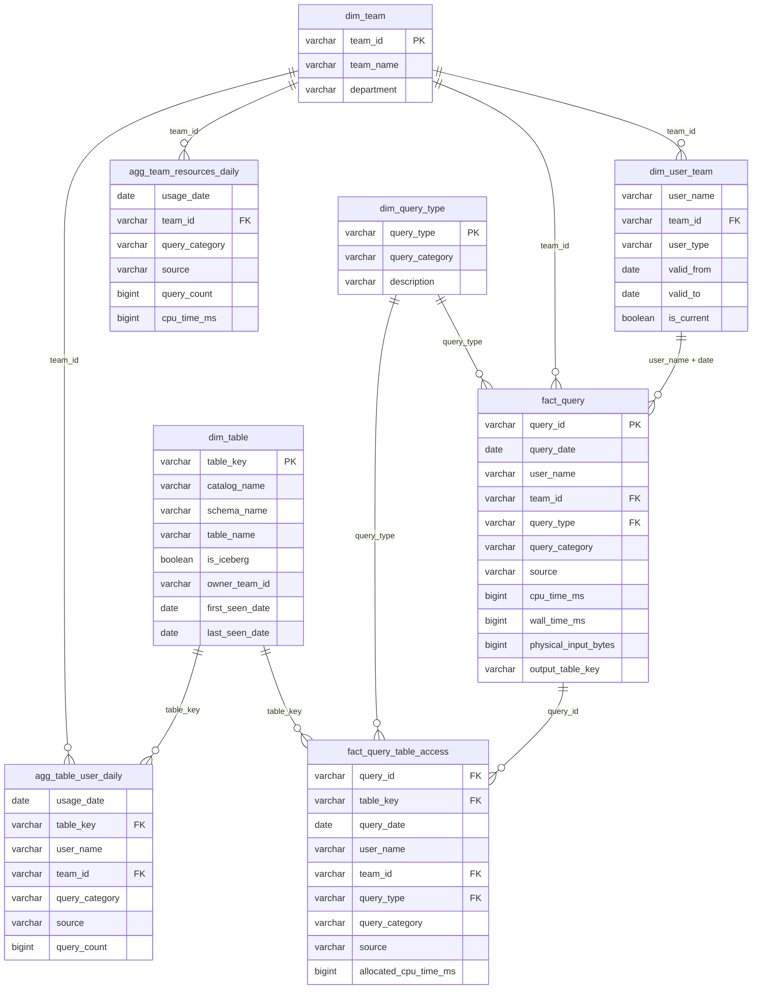

# Meta DWH: Iceberg table usage model

Data model and transformations that collect usage statistics of Apache Iceberg
tables queried through Trino: who reads which tables, how many resources teams
consume, and how this changes over time.

## Summary

| Task requirement | Where |
| --- | --- |
| Tables, granularity, relationships | [Data model](#data-model), [ER diagram](#er-diagram) |
| SQL / Python to create and populate | `sql/ddl/`, `sql/seed/`, `sql/transform/`, `pipeline/`, [Running locally](#running-locally) |
| Example queries | `sql/examples/`, run with `python -m pipeline.run_examples`; answers in [Example results](#example-results) |
| Resource usage metrics | [Resource metrics](#resource-metrics), [Query categories](#query-categories) |
| How data is updated | [How data is updated](#how-data-is-updated), [Data quality checks](#data-quality-checks), [Table maintenance](#table-maintenance-compaction-and-snapshots) |
| Assumptions | [Assumptions](#assumptions) |
| Additional metadata | [Required metadata beyond the query log](#required-metadata-beyond-the-query-log) |

In short:

- **Input:** the Trino query log (one `QueryCompletedEvent` per query) landed as
  an Iceberg table `raw.trino_query_completed`.
- **Model:** a star schema in `meta`: four dimensions, two facts (per query and
  per query x table read) and two daily aggregates. Facts and aggregates keep
  full history with a date column (facts partitioned by day, aggregates by month),
  so any period and trend can be queried.
- **"Distinct users of table X":** `count(DISTINCT user_name)` over
  `agg_table_user_daily`, which keeps user granularity because distinct counts
  cannot be summed across days.
- **"Resources of team Y":** sums of CPU time and bytes read from
  `agg_team_resources_daily`. A query belongs to the team the user was in on the
  query date (user -> team history as SCD Type 2).
- **Queries reading several tables:** full cost stays on the query; CPU is split
  across tables proportionally to bytes read.
- **Updates:** daily loads per date, idempotent (delete + insert), so re-runs and
  backfills are safe. Data quality checks run after every load; a weekly job
  applies retention and Iceberg maintenance. Handling of late events is described.
- **Run it:** `bash run_all.sh` starts a local S3 + Iceberg + Trino stack,
  generates sample events, builds the model, checks it, prints the answers of the
  example queries and runs maintenance (see [Running locally](#running-locally)).

## Required metadata beyond the query log

The Trino query log says who ran a query and which tables it read. It does not
say which team a person works in or which tables exist at all. To answer the
task questions the model needs additional metadata:

| Metadata | Why it is needed | Source in production | In this repo |
| --- | --- | --- | --- |
| User -> team mapping, with history | Attribute queries and resources to teams ("how many resources did team Y consume") | HR system / corporate directory, daily export | `sql/seed/02_dim_user_team.sql` |
| Team reference | Team names and departments for reports | HR / org chart | `sql/seed/01_dim_team.sql` |
| Owners of service accounts | Attribute pipelines and BI tools (`svc_airflow`, `svc_superset`) to a team instead of `unknown` | Platform team config or directory | Same seed, `user_type = 'service'` |
| Full list of tables | Find tables that were **never** read: `dim_table` is built from the log and only contains tables read at least once | Iceberg REST catalog / `information_schema` | Not implemented |
| Table owner team | Filter "our tables", attribute storage cost to the owner | Data catalog (DataHub, OpenMetadata) or Iceberg table properties | Not implemented, `dim_table.owner_team_id` is NULL |
| Event ingestion time | Measure how late events arrive (see [Late-arriving events](#late-arriving-events)) | Written by the event delivery pipeline | Not implemented |

Structure of the metadata that is not implemented yet:

**Table catalog snapshot**: `meta.catalog_table_daily`, one row per table per day,
loaded daily from the Iceberg REST catalog (or `information_schema.tables` of each
Trino catalog).

| Column | Type | Description |
| --- | --- | --- |
| `snapshot_date` | DATE | Day of the snapshot |
| `table_key` | VARCHAR | `catalog.schema.table`, joins to `dim_table` and the facts |
| `table_type` | VARCHAR | Table or view |
| `created_at` | TIMESTAMP | When the table was created |
| `size_bytes`, `file_count` | BIGINT | Storage size, from Iceberg metadata (`$files` / `$snapshots`) |

Used for: tables that exist but were never read (catalog left-joined with
`agg_table_user_daily`), storage growth over time, small files.

**Table ownership**: `meta.table_owner`, one row per table per ownership period
(SCD Type 2, like `dim_user_team`).

| Column | Type | Description |
| --- | --- | --- |
| `table_key` | VARCHAR | `catalog.schema.table` |
| `owner_team_id` | VARCHAR | Joins to `dim_team` |
| `valid_from`, `valid_to` | DATE | Ownership period |

Source: data catalog, Iceberg table property `owner`, or a reviewed config file
in the repository. Used for: filling `dim_table.owner_team_id`, "who outside the
owner team reads our tables", attributing storage cost to the owner. Writers of
a table (`fact_query.output_table_key`) can suggest the owner when it is missing.

**Ingestion time**: one more column in the raw table.

| Column | Type | Description |
| --- | --- | --- |
| `ingested_at` | TIMESTAMP WITH TIME ZONE | When the event was written to `raw.trino_query_completed` |

Used for: measuring event lateness (`ingested_at - end_time`) to choose the reload
window for late-arriving events.

## Architecture

```text
 Analyst / service ── SQL ──► Trino ◄── reads ── S3 + Iceberg (product tables)
                                │
                                │ QueryCompletedEvent (event listener)
                                ▼
 [raw]   raw.trino_query_completed           1 row = 1 query, as produced by Trino
                                │
                                │ daily, idempotent load per date (Airflow / run_daily.py)
                                ▼
 [facts] meta.fact_query                     1 row = 1 query (+ team)
         meta.fact_query_table_access        1 row = 1 query x 1 table read
                                ▲
                                │ lookup
 [dims]  meta.dim_user_team (SCD2), meta.dim_team, meta.dim_table, meta.dim_query_type
                                │
                                ▼
 [aggs]  meta.agg_table_user_daily           1 row = day x table x user x category x client
         meta.agg_team_resources_daily       1 row = day x team x category x client
```

## Data model

| Table | Grain | Source | Purpose |
| --- | --- | --- | --- |
| `raw.trino_query_completed` | query | Trino event listener | Raw query events, as produced by Trino |
| `meta.dim_team` | team | HR / org chart (seed locally) | Team reference |
| `meta.dim_user_team` | user x validity period (SCD2) | HR / directory (seed locally) | Which team a user belonged to on a given date |
| `meta.dim_table` | table (`catalog.schema.table`) | built from facts | Tables ever read, first/last seen |
| `meta.dim_query_type` | Trino query type | our config (seed) | Groups query types into reporting categories |
| `meta.fact_query` | query | built from raw | Full resource usage per query, attributed to a team |
| `meta.fact_query_table_access` | query x table | built from raw | Which tables a query read; CPU allocated per table |
| `meta.agg_table_user_daily` | day x table x user x category x client | built from facts | Distinct users and usage per table over any period |
| `meta.agg_team_resources_daily` | day x team x category x client | built from facts | Resource consumption per team |

Only `dim_team` and `dim_user_team` come from outside: the query log knows user
names but not teams. `dim_query_type` is a small mapping maintained in this repo.
Everything else is derived from the raw query events.

### Why two fact tables

They have different grains and answer different questions:

- **`fact_query`** (one row per query) answers *"how many resources did team Y
  consume"*. Every query is counted exactly once, so all metrics (CPU, wall time,
  memory, bytes) can be summed safely.
- **`fact_query_table_access`** (one row per query x table) answers *"how many
  distinct users queried table X"*. A query that reads three tables has three
  rows here, so query-level metrics like wall time would be triple-counted.
  Only CPU is split across tables (`allocated_cpu_time_ms`): the shares are whole
  milliseconds and sum exactly to the query total (largest remainder rounding,
  verified by check 05).

### ER diagram

Relationships are logical: Iceberg has no foreign keys. `dim_user_team` is
joined by `user_name` **and** by date (`valid_from <= date < valid_to`).



### Column descriptions

**`raw.trino_query_completed`**: one row per completed query (`QueryCompletedEvent`).

| Column | Description |
| --- | --- |
| `query_id` | Unique Trino query id |
| `query_state` | `FINISHED` or `FAILED` |
| `error_code` | Error name for failed queries, otherwise NULL |
| `query_type` | `SELECT`, `INSERT`, `MERGE`, ... |
| `user_name` | Trino user (a person or a service account) |
| `source` | Client that sent the query: `datagrip`, `airflow`, `superset`, ... |
| `resource_group_id` | Trino resource group the query ran in |
| `query_text` | SQL text |
| `create_time`, `execution_start_time`, `end_time` | When the query was submitted, started and finished (UTC) |
| `cpu_time_ms`, `wall_time_ms`, `queued_time_ms` | Resource statistics, see [Resource metrics](#resource-metrics) |
| `peak_memory_bytes` | Peak memory used by the query |
| `physical_input_bytes`, `physical_input_rows` | Data read from storage |
| `output_bytes` | Size of the query result |
| `inputs` | Array of tables read: catalog, schema, table, columns, bytes read from that table |
| `output_catalog`, `output_schema`, `output_table` | Table written by the query, if any |
| `event_date` | UTC date of `end_time`; partition key |

**`meta.dim_team`**

| Column | Description |
| --- | --- |
| `team_id` | Team key. `unknown` is used for users missing from the directory |
| `team_name` | Human-readable name |
| `department` | Department the team belongs to |

**`meta.dim_user_team`** (SCD Type 2)

| Column | Description |
| --- | --- |
| `user_name` | Trino user name |
| `team_id` | Team the user belonged to in this period |
| `user_type` | `human` or `service` |
| `valid_from`, `valid_to` | Validity period `[valid_from, valid_to)`; the current row has `valid_to = 9999-12-31` |
| `is_current` | True for the current row of the user |

**`meta.dim_query_type`**

| Column | Description |
| --- | --- |
| `query_type` | Trino query type (`SELECT`, `INSERT`, `DESCRIBE`, ...) |
| `query_category` | `read`, `write`, `maintenance` or `metadata`, see [Query categories](#query-categories) |
| `description` | What these queries are |

`query_category` is not unique, so the aggregates (grouped by category) do not
join to this table: the category is resolved once per query in `fact_query`.

**`meta.dim_table`**

| Column | Description |
| --- | --- |
| `table_key` | `catalog.schema.table` |
| `catalog_name`, `schema_name`, `table_name` | Parts of the key |
| `is_iceberg` | True if the table is in an Iceberg catalog |
| `owner_team_id` | Team that owns the table (not filled yet) |
| `first_seen_date`, `last_seen_date` | First and last day the table was read through Trino |

**`meta.fact_query`**

| Column | Description |
| --- | --- |
| `query_id` | Trino query id; unique (duplicate events are removed at load) |
| `query_date` | UTC date of `end_time`; partition key |
| `user_name` | Trino user |
| `team_id` | User's team on `query_date` (from `dim_user_team`), `unknown` if not found |
| `query_state`, `query_type`, `source` | Copied from raw |
| `query_category` | Category from `dim_query_type`; a `SELECT` that reads no data tables is `metadata` (see [Query categories](#query-categories)) |
| `create_time`, `end_time` | Copied from raw |
| `cpu_time_ms`, `wall_time_ms`, `queued_time_ms`, `peak_memory_bytes`, `physical_input_bytes`, `output_bytes` | Full resource usage of the query |
| `input_table_count` | Number of distinct data tables the query read (system tables not counted) |
| `output_table_key` | Table the query wrote (`catalog.schema.table`), NULL for reads |

**`meta.fact_query_table_access`**

| Column | Description |
| --- | --- |
| `query_id`, `query_date`, `user_name`, `team_id`, `query_type`, `query_category`, `source` | Same as in `fact_query` |
| `table_key` | Data table read by the query (`information_schema` and the `system` catalog are left out) |
| `is_successful` | True if the query finished successfully |
| `column_count` | Number of columns read from this table |
| `physical_input_bytes` | Bytes read from this table |
| `allocated_cpu_time_ms` | Share of the query CPU attributed to this table: proportional to bytes read, equal split if bytes are unknown for any table of the query. Shares sum exactly to the query CPU |

**`meta.agg_table_user_daily`**

| Column | Description |
| --- | --- |
| `usage_date` | Day |
| `table_key`, `user_name`, `team_id` | Who read which table |
| `query_category`, `source` | Query category and client |
| `query_count`, `failed_query_count` | Number of queries (all / failed) |
| `physical_input_bytes`, `allocated_cpu_time_ms` | Bytes read and CPU attributed to this table |

**`meta.agg_team_resources_daily`**

| Column | Description |
| --- | --- |
| `usage_date`, `team_id` | Day and team |
| `query_category`, `source` | Query category and client |
| `query_count`, `failed_query_count` | Number of queries (all / failed) |
| `active_user_count` | Distinct users within this row only. Not additive: do not sum over days, categories or clients; count distinct users for a period from `fact_query` or `agg_table_user_daily` |
| `cpu_time_ms`, `wall_time_ms`, `queued_time_ms`, `physical_input_bytes`, `output_bytes` | Sums over all queries of the team |

## Resource metrics

"Resources" are measured with the statistics Trino reports for every query.
They answer different questions, so all of them are kept:

| Metric | What it measures | Role |
| --- | --- | --- |
| `cpu_time_ms` | CPU time summed over all workers and threads | **Main cost metric** |
| `physical_input_bytes` | Bytes read from storage (S3) | **Main cost metric** |
| `wall_time_ms` | Elapsed time from start to finish | User experience, not cost |
| `queued_time_ms` | Time waiting for a free slot in the cluster | Sign of cluster overload |
| `peak_memory_bytes` | Maximum memory used at once | Risk of out-of-memory failures |
| `output_bytes` | Size of the result | Extracts and exports |

Why CPU time and bytes read are the main ones:

- **They are additive.** CPU seconds and bytes of different queries can be
  summed, and the total is meaningful: "team Y used 120 CPU hours and read
  15 TiB in October". Wall time is not: ten queries running in parallel for one
  minute take ten minutes of wall time in total, but only one minute of real time.
  Peak memory cannot be summed at all.
- **They map to money.** Cluster size (and cost) is driven by how much CPU work
  it has to do. Bytes read map to S3 request and transfer costs and are the main
  driver of CPU for typical analytical scans.
- **They do not depend on cluster load.** The same query has roughly the same CPU
  time and bytes read on a quiet or a busy cluster, while wall time and queued
  time grow when the cluster is busy. This makes CPU and bytes fair for comparing
  teams.

Wall time and queued time are still useful to find slow dashboards and capacity
problems, so they are kept on `fact_query` and in the team aggregate.

## Query categories

Resource usage is also split by **what kind of work** a query does and by
**which client** sent it. This answers "what does team Y spend resources on":
using data (dashboards, analysis) or producing it (pipelines).

Trino reports about ten query types (`queryType` in the event). That is too
detailed for reports, so `dim_query_type` groups them into four categories:

| Category | Trino query types | Typical workload |
| --- | --- | --- |
| `read` | `SELECT` that reads data tables | Analysis, dashboards, exports |
| `write` | `INSERT` (incl. `CREATE TABLE AS`), `MERGE`, `UPDATE`, `DELETE` | Pipelines that build and update tables |
| `maintenance` | `ALTER_TABLE_EXECUTE`, `ANALYZE` | Compaction, snapshot expiry, statistics |
| `metadata` | `DATA_DEFINITION`, `DESCRIBE`, `EXPLAIN`, and `SELECT` that reads no data tables | CREATE / DROP / ALTER, SHOW and DESCRIBE, query plans, IDE introspection, `SELECT 1` |

Why these four:

- **`read` vs `write`** is the main split: the cost of *using* data versus the
  cost of *producing* it. A query like `INSERT INTO x SELECT ... FROM y` is one
  `write` query that reads `y` (event `inputs`) and writes `x` (event output).
- **`maintenance`** is kept apart so that a weekly `optimize` does not look like
  a team suddenly writing a lot.
- **`metadata`** queries are almost free but very numerous. IDEs such as DataGrip
  send many of them on their own: to build the schema tree they run `SELECT`s on
  `information_schema` and `system.jdbc` tables when connecting or refreshing, and
  `SHOW` / `DESCRIBE` when a table is opened. Without a separate category they
  inflate query counts and make "who is active" look different from "who uses
  resources". In the local sample data they are 27% of all queries but 0.15% of CPU.
- **System tables are not data tables.** `information_schema` (in every catalog)
  and the `system` catalog are left out of `fact_query_table_access` and
  `dim_table`, so introspection never makes someone a "user of a table". A `SELECT`
  that reads only system tables, or no tables at all (`SELECT 1` connection
  checks), is therefore `metadata`, not `read`.
- **Client (`source`)** is reported next to the category: `airflow` (scheduled
  pipelines), `superset` (dashboards), `datagrip` / `jupyter` (manual work).
  Together they give a breakdown like "Data Engineering: 28% of CPU is `write`
  from `airflow`, 38% is `read` from `datagrip`".

Design decisions:

- The category is resolved once per query when `fact_query` is loaded
  (`dim_query_type` plus the `SELECT` rule above) and copied to the other tables,
  so every report uses the same category. The original `query_type` is kept too.
  To change the grouping, edit `sql/seed/03_dim_query_type.sql` and reload the
  period with `run_daily` (a backfill); raw data stays as it is. Unknown types are
  reported as `other`.
- Reports use **sums and shares**, not averages per query: one large `MERGE` and a
  thousand small `SELECT`s give a meaningless average.
- Adding category and client to the aggregates multiplies rows only by the number
  of combinations actually used (a few per team or user per day), not by the
  number of queries.
- `active_user_count` counts distinct users within one day x team x category x
  client row and cannot be summed. Distinct users for any period or slice are counted with
  `count(DISTINCT user_name)` on `fact_query` or `agg_table_user_daily`.
  For very large volumes, approximate distinct counts can be stored as HyperLogLog
  sketches (`approx_set` / `merge` in Trino) instead.
- Writes also tell who produces a table (`fact_query.output_table_key`), which is
  a useful hint for the table owner (`dim_table.owner_team_id`).

See `sql/examples/03_query_categories.sql` and [Example results](#example-results).

## Example results

Answers of `sql/examples/` on the local sample data (October 2026, 200 fake
queries per day). The full output is in `output/example_results.txt`;
`bash run_all.sh` produces exactly the same numbers (fixed random seed).

**Q1. Distinct users of `iceberg.product.events` in October:** 8 users, 1,510
queries. The weekly trend is flat: all 8 users read it every week.

**Q2. Resources of Product Analytics in October:** 1,727 queries, 8.64 CPU hours,
2.37 TiB read; 6.86 of the CPU hours went to `iceberg.product.events`.

**Team history (SCD Type 2) in the weekly trend.** `anna` moved from Product
Analytics to ML Research on 15 October. Her queries before that date stay with
Product Analytics, later ones go to ML Research, so the two teams cross over:

| Week starting | Product Analytics, CPU h | ML Research, CPU h |
| --- | --- | --- |
| 2026-09-28 (only 1-4 Oct) | 1.29 | 0.40 |
| 2026-10-05 | 2.74 | 0.93 |
| 2026-10-12 (move on 15 Oct) | 2.04 | 1.54 |
| 2026-10-19 | 1.40 | 1.72 |
| 2026-10-26 (only 26-31 Oct) | 1.18 | 1.48 |

The first and last weeks are partial, so their numbers are lower.

**Q3. What Data Engineering spends CPU on:** 38% `read` from DataGrip, 28% `write`
from Airflow, 26% `read` from Jupyter, 5% `maintenance`. Across all teams,
`metadata` queries are 27% of all queries but 0.15% of CPU. All writes to the
three output tables come from `svc_airflow` (Data Engineering), a hint for the
table owner.

## How data is updated

- Each transformation in `sql/transform/` loads **one date** (`{{ run_date }}`).
- Loads are idempotent: the rows of the date are deleted and re-inserted
  (`dim_table` uses `MERGE`), so re-runs and backfills are safe.
- Raw events are deduplicated by `query_id` during the load: event delivery is
  at-least-once, so the same event can arrive twice.
- Raw events and facts are partitioned by day: a daily load replaces exactly one
  partition, and reports read only the days they need. Aggregates are partitioned
  by month: they have a few hundred rows per day, so daily partitions would hold
  tiny files, and a month is still quick to read. Reloading one day inside a
  monthly partition is a row-level delete that writes small delete files; the
  weekly compaction merges them away. Dimensions are small and not partitioned.
- Files are numbered in dependency order.
- In production this is an Airflow DAG with one run per logical date;
  a backfill is the same DAG run for past dates.
- After each load, data quality checks verify the result; a failed check fails
  the DAG run, so a problem is alerted instead of silently showing up in reports
  (see below).
- Once a week a separate maintenance job applies retention and compacts the tables.

### Late-arriving events

Events can reach the raw table after their day has already been loaded, for
example when the event delivery pipeline is down for a few hours or a cluster
buffers events and sends them later. A day loaded too early stays incomplete.

Because every load is idempotent per date, the fix is to load a day again later.
How often and how late is a trade-off between freshness, completeness and compute
cost, so it should be based on measurements rather than guessed:

1. **Measure.** Store the ingestion time of each event and track the lag
   `ingested_at - end_time`, plus how long and how much CPU one daily load takes.
2. **Start conservatively.** Load day D once, on D+2. One run per day, complete
   data, but reports are one day behind. If consumers need fresher numbers, add
   a preliminary load on D+1 and treat the D+2 load as final.
3. **Tune.** If events are almost never late, load D on D+1 only. If they often
   are and loads are cheap, reload more days. With idempotent loads this is a
   runner parameter (dates to reload), not a change in the SQL.
4. Events later than the reload window are picked up only by a manual backfill.

Not implemented yet: the runner currently loads exactly the dates it is given.

### Data quality checks

After every load `pipeline/checks.py` runs the queries in `sql/checks/`. Each
query returns the rows that break one rule, so an empty result means the check
passed. A failed check makes the script exit with code 1, which fails the
Airflow task and stops the tasks after it. Checks marked `severity: warn` only
print a warning: the data is still correct, but something needs attention.

| Check | What it catches |
| --- | --- |
| `01_raw_no_empty_days` | A day without any events: event delivery was down |
| `02_fact_query_unique` | The same query loaded twice, so its resources are counted twice (a safety net: the load already drops duplicate events) |
| `03_fact_query_matches_raw` | Queries lost or duplicated between `raw` and `fact_query` |
| `04_fact_query_required_fields` | Empty keys (user, team, query type) or negative metrics |
| `05_table_access_cpu_matches_query` | Per-table CPU does not add up exactly to the query CPU, or a table row is missing |
| `06_agg_team_resources_matches_fact` | Team aggregate differs from `fact_query`: queries, CPU or bytes per day |
| `07_agg_table_user_matches_access` | Table aggregate differs from `fact_query_table_access` |
| `08_dim_table_covers_access` | A table read in the period is missing from `dim_table` |
| `09_users_without_team` (warn) | Users missing from the directory; their usage goes to `unknown` |
| `10_unknown_query_types` (warn) | Query types missing from `dim_query_type`; reported as `other` |
| `11_dim_user_team_no_overlaps` | Overlapping user -> team periods: a query would get two teams and be loaded twice |

`run_all.sh` runs the checks for the whole period right after the load; other
ways to run them are in [Running locally](#running-locally). Every check was
also tried on deliberately broken data (part of an aggregate day deleted, an
unknown user and query type, a table removed from `dim_table`, overlapping team
periods) and reported exactly the broken rows. A raw event delivered twice no
longer breaks anything: the load drops the copy and all checks pass.

The checks compare the model with `raw`, so they are meant for recently loaded
days. After retention has removed old raw events, checks 01 and 03 fail for those
days by design.

The checks run after the data is written, so for a short time reports can see a
bad load. Iceberg supports *write-audit-publish* to close this gap: load into a
branch, run the checks there and publish only if they pass. It is not used here
to keep the pipeline simple.

### Retention

Each layer keeps as much history as it is useful for, because storage costs money
and the raw query text may contain personal data (e.g. `WHERE email = '...'`).
Proposed periods (to be agreed with data governance):

| Layer | Keep | Why |
| --- | --- | --- |
| `raw` | 90 days | Large, contains query text. Enough to investigate issues and to rebuild facts after a logic change |
| `fact_*` | 2 years | No query text, but many rows. Needed for detailed analysis |
| `agg_*`, `dim_*` | Forever | Small, used for long-term trends |

Consequence: facts can be rebuilt (backfilled) only for the period still kept in `raw`.

Retention is a `DELETE` of old partitions, run as the first step of the weekly
maintenance job (below), e.g.
`DELETE FROM iceberg.raw.trino_query_completed WHERE event_date < current_date - INTERVAL '90' DAY`.
Tables are partitioned by date, so Iceberg drops whole files. In Iceberg a
`DELETE` only removes files from the current snapshot: the files stay in storage
until old snapshots are expired (see below).

### Table maintenance (compaction and snapshots)

Iceberg never modifies files: every write adds new data files and a new snapshot.
Two kinds of garbage pile up over time:

- **Small files.** Frequent small writes (event ingestion in micro-batches, daily
  loads of small aggregates) create many small files. Reading many small files
  is slow, because opening each file is a separate S3 request. *Compaction*
  rewrites them into fewer large files (~128-512 MB) without changing the data:
  `ALTER TABLE ... EXECUTE optimize`.
- **Old snapshots.** Every `DELETE` + `INSERT` keeps the replaced files for time
  travel, so storage grows forever and data removed by retention is still
  physically present. `ALTER TABLE ... EXECUTE expire_snapshots(retention_threshold => '7d')`
  drops snapshots older than 7 days and deletes files no snapshot refers to.
  `remove_orphan_files` cleans up files left by failed writes.

`pipeline/maintenance.py` is a weekly job that runs, for every table in `raw` and
`meta`: retention, then `optimize`, `expire_snapshots` (7 days: the window in
which a bad load can still be rolled back with time travel) and
`remove_orphan_files`. Retention periods are set at the top of the script. In production it
is a weekly Airflow DAG; locally `run_all.sh` runs it as the last step (see
[Running locally](#running-locally) for other options).

What it does on the local sample data (October 2026):

- `--as-of 2027-01-15` deletes the raw events of 1-16 October (older than 90
  days on that date); facts and aggregates are kept.
- `optimize` compacts each aggregate from 31 small files (one per daily load)
  into one, and `dim_table` from 61 files (every daily `MERGE` adds a data file
  and a delete file) into one. Facts already have one file per daily partition, so there is nothing to
  merge.
- `expire_snapshots` removes nothing locally: all snapshots are younger than 7
  days, and Trino does not accept a shorter threshold by default
  (`iceberg.expire-snapshots.min-retention`).
- Maintenance changes how the data is stored, not the data: the example queries
  return the same results before and after it. Retention would change them only
  for periods older than the retention: raw events are not used by reports, and
  facts are kept for 2 years.

## Assumptions

- **Input is the Trino query log.** Trino emits one `QueryCompletedEvent` per
  query through an event listener; we assume it is already landed as an Iceberg
  table (`raw.trino_query_completed`). "Tables being used" means the data tables
  read by those queries, taken from the event's `inputs`, not the log table itself.
- **Only access through Trino is visible.** Spark jobs or scripts that read S3
  files directly do not go through Trino and leave no events. Covering them would
  need another source, such as Iceberg catalog or S3 access logs.
- **User -> team mapping comes from an HR / directory export** and is stored as
  SCD Type 2. People move between teams; a query is attributed to the team the user
  was in on the query date, so history does not change when someone moves.
- **Service accounts are mapped to their owning team** (e.g. `svc_airflow` ->
  Data Engineering). Otherwise a large share of the load (scheduled pipelines,
  BI dashboards) would end up in `unknown`.
- **Users missing from the directory go to the `unknown` team** instead of being
  dropped, so total resources always add up.
- **Events can arrive more than once** (at-least-once delivery), but `query_id`
  is unique per query, so duplicates are dropped at load.
- **A query reading several tables:** full resources stay on `fact_query`; per-table
  CPU is allocated proportionally to bytes read (equally if bytes are unknown for
  any of them). A table that produced more data usually cost more CPU to scan, so
  this is a reasonable approximation without per-operator statistics.
- **A query can read several data sources.** Trino can join an Iceberg table with,
  for example, a PostgreSQL table in one query. Such a query is one row in
  `fact_query`, and each table, whatever its catalog, gets its own row and CPU
  share in `fact_query_table_access`. Non-Iceberg tables are kept and flagged with
  `dim_table.is_iceberg`: they still consume Trino resources, and filtering them
  out is a one-line `WHERE`.
- **The table format is derived from the catalog name.** `is_iceberg` is true when
  the catalog is called `iceberg`. This holds locally but not in general (catalogs
  can be named `lake`, `iceberg_prod`, ...). In production it should come from the
  catalog configuration: `system.metadata.catalogs` gives the connector of each
  catalog.
- **System tables are metadata, not data.** Reads of `information_schema` and of
  the `system` catalog (IDE introspection) are not counted as table usage.
- **Failed queries count towards resource usage.** They used CPU and read data
  before failing, so they cost the cluster the same.
- **A "day" is the UTC date of the query `end_time`.** UTC avoids time zone and
  daylight saving issues; `end_time` is when the event is emitted, so a query is
  assigned to exactly one day.

## Repository layout

```text
docker-compose.yml        local stack: SeaweedFS (S3) + Iceberg REST catalog + Trino
trino/catalog/            Trino catalog configuration
sql/ddl/                  CREATE SCHEMA / CREATE TABLE
sql/seed/                 sample dimension data (teams, user -> team)
sql/transform/            daily idempotent loads, parameterised by {{ run_date }}
sql/checks/               data quality checks, run after each load
sql/examples/             queries answering the task questions
pipeline/                 Python: init, fake event generator, daily runner, checks,
                          maintenance, example runner
run_all.sh                runs the whole local pipeline end to end
output/                   example query results, rewritten by every run of run_all.sh
```

## Running locally

Requirements: Docker, Python 3.10+ (tested on Ubuntu in WSL).
All commands are run from the repository root.

### Quick start

```bash
bash run_all.sh                          # October 2026, 31 days
START=2026-11-01 DAYS=7 bash run_all.sh  # another period
```

The script first checks that Docker and Python are installed and running, and
if not, prints how to install or start them. Then it does every step from the
next section, in order: starts the Docker stack (removing old data first),
prepares the Python environment, creates the tables, generates fake events,
builds the model, runs the data quality checks, runs the example queries and
finally runs table maintenance. It stops with an error if any step or check
fails. The example results are printed and also saved to
`output/example_results.txt`.

### Step by step

```bash
docker compose down                  # remove old data, if the stack was running
docker compose up -d                 # wait ~30 s until Trino is ready

# Python dependencies go into a virtual environment
# (Ubuntu does not allow `pip install` into the system Python)
python3 -m venv .venv                # once; may need `sudo apt install python3-venv`
source .venv/bin/activate            # in every new terminal
pip install -r requirements.txt

python -m pipeline.init_db                                          # 1. tables + seed dimensions
python -m pipeline.generate_events --start 2026-10-01 --days 31     # 2. fake raw events
python -m pipeline.run_daily --start 2026-10-01 --end 2026-10-31    # 3. build facts and aggregates
python -m pipeline.checks --start 2026-10-01 --end 2026-10-31       # 4. data quality checks
python -m pipeline.run_examples                                     # 5. example queries and their results
python -m pipeline.maintenance --as-of 2026-10-31                   # 6. retention, compaction, snapshots
```

### Other useful commands

```bash
python -m pipeline.run_daily --date 2026-10-15                      # reload one day (safe to repeat)
python -m pipeline.checks --date 2026-10-15                         # check one day
python -m pipeline.run_examples sql/examples/02_team_resources.sql  # run one example file
python -m pipeline.maintenance --dry-run                            # only print the maintenance statements
python -m pipeline.maintenance --as-of 2027-01-15                   # retention as if it were a later day
```

Without `--as-of`, maintenance counts retention from today, as it would in
production. The sample data is from October 2026, so a few months later a plain
run would delete its raw events as older than 90 days. That is why `run_all.sh`
and the steps above pass the last generated day as `--as-of`.

### Your own queries

Connect DataGrip (Trino data source, `localhost:8080`, any user, no password),
or open the Trino CLI:

```bash
docker compose exec trino trino
```

### Notes

The local stack is ephemeral: `docker compose down` removes all data.
After changing anything in `sql/ddl/`, recreate the stack (`docker compose down`,
`docker compose up -d`) and run all steps again: `CREATE TABLE IF NOT EXISTS`
does not change existing tables.
SeaweedFS is used as a local S3-compatible storage in place of Amazon S3.
